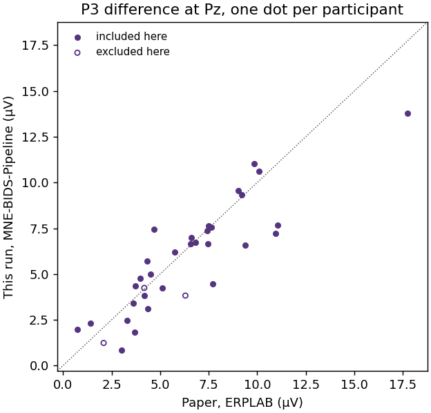

# ERP CORE on NSG: the P3 in 40 participants

The [PURSUE lesson](../pursue-p300/README.md) measures a P300 in one recording. This lesson measures the same kind of response in all 40 participants of [ERP CORE](https://erpinfo.org/erp-core), an open dataset from Steven Luck's lab, and compares the result with the published values. The analysis is [MNE-BIDS-Pipeline](https://mne.tools/mne-bids-pipeline/1.10/examples/ERP_CORE.html), configured by one file. The job runs on the Neuroscience Gateway (NSG) CPU tool "Python on Expanse".

ERP CORE has six tasks and seven components (N170, MMN, N2pc, N400, P3, LRP and ERN). This lesson starts with the P3 from the active visual oddball task: the letters A to E appear one at a time, one letter is the target for a block, and participants press one button for the target and another for the other letters. Targets appear on 20% of trials.

## Inspect a result first


This is the output of a full run on all 40 participants (see [How the example was made](#how-the-example-was-made)).

| | Participants | Target minus non-target at Pz, 300 to 600 ms |
|---|---|---|
| This run | 32 of 40 | 6.17 µV (SD 3.01) |
| Kappenman et al. (2021), Table 3 | 34 of 40 | 6.29 µV (SD 3.39) |

ERP CORE also publishes each participant's value. For the 31 participants that both analyses kept, the two sets of values correlate at r = 0.88, and they differ by 1.2 µV on average (absolute difference).



Questions to try:

- Why is the target trace noisier than the non-target trace? Look at the trial counts in [subject-amplitudes.tsv](example/subject-amplitudes.tsv).
- Which participants did this run exclude that the paper kept, and why? Compare `excluded` with `paper_excluded` in [comparison.json](example/comparison.json).
- Both traces show a peak near 130 ms before they separate. Is that peak part of the P3?

## Submit the job

1. [Register or sign in to NSG](https://nsgprod.sdsc.edu:8443/portal2/). The web portal uses your own NSG account.
2. Clone this repository and build the input ZIP with Python 3.11 or later. The ZIP holds only code and the file lists (about 100 KB).

   ```sh
   git clone https://github.com/NeuroTechX/nemar-nsg-starter.git
   cd nemar-nsg-starter/lessons/erp-core
   python3 prepare.py zip erp_core.zip
   ```

3. Under **Data → Upload Data**, upload `erp_core.zip`. Create a task with the **Python on Expanse** tool (`PY_EXPANSE`). Set the main input file to `run.py` and its subdirectory to `erp_core`. Request 2 hours. See the [portal walkthrough](../../docs/submit-portal.md) for the task screens.
4. When the task finishes, download the output and open `erp_core/results/grand-average.png`. The other files are described in [What the job writes](#what-the-job-writes).

The job downloads the 40 P3 recordings (2.2 GB) from OSF into the node's scratch space and checks each file against the SHA-256 that OSF reports, listed in [manifests/P3.tsv](manifests/P3.tsv). It then installs the pinned packages in [requirements.txt](requirements.txt) into scratch, because the tool's own Python environment is read-only and has older versions (MNE 1.5.1, NumPy 1.25.2). Neither the data nor the packages are written to the job directory, so the output you download stays small (about 8 MB). The scratch space needs about 5.5 GB.

Both steps need internet access from the compute node. That worked on the NSG GPU tool in 2026 (see [FINDINGS.md](../../docs/FINDINGS.md)), but NSG does not document it. ERP CORE is not on OpenNeuro, so it is not in NEMAR's copy on Expanse.

### When the job has no internet access

Bundle the packages and the data in the ZIP. Start with a few participants to keep the upload small. Each P3 recording is about 55 MB, and the wheels add about 250 MB.

```sh
python3 prepare.py fetch data/ERP_CORE --subjects 001,002,003
python3 prepare.py zip erp_core_offline.zip --subjects 001,002,003 --include-data data/ERP_CORE --wheels
```

The job reads the bundled files, then deletes the bundle from the job directory before it ends, so NSG does not send it back. NSG does not publish an upload size limit. For inputs over 5 GB, NSG offers Globus transfers on request.

## Run it on your own computer

You need Python 3.11 and about 1 GB of disk for the packages, 2.2 GB for the P3 data of all 40 participants, and 2.2 GB for the pipeline's intermediate files.

```sh
python3.11 -m venv .venv
. .venv/bin/activate
python -m pip install -r requirements.txt
python prepare.py fetch data/ERP_CORE --subjects 001,002,003
python run.py --dataset-root data/ERP_CORE --subjects 001,002,003 --skip-install --jobs 3
```

Three participants take about two minutes. Pipeline derivatives go to `$TMPDIR/erpcore/derivatives` (set `--deriv-root` to keep them elsewhere). Results go to `results/`.

## What the job writes

| File | Contents |
|---|---|
| `grand-average.png` | Grand average at Pz, the difference wave with ±1 SEM, and each participant's mean amplitude |
| `vs-paper.png` | Each participant's value against the value published by ERP CORE |
| `grand-average.tsv` | The plotted traces in µV |
| `subject-amplitudes.tsv` | Per participant: accuracy, trials found, usable and kept, mean amplitudes, exclusion reasons and the published value |
| `comparison.json` | This run against Table 3 of the paper and against the published per-participant values |
| `run-manifest.json` | Dataset, package versions, measurement settings and run time |
| `evoked/` | Each participant's averaged ERPs (MNE `.fif`) |
| `reports/` | The pipeline's group report (HTML) |

## What the analysis does

[config_erpcore.py](config_erpcore.py) adapts the ERP CORE example that ships with MNE-BIDS-Pipeline 1.10.1 to follow the paper's methods more closely:

- 256 Hz sampling, a 0.1 Hz high-pass filter and no low-pass filter, as in the paper's mean amplitude measures.
- Reference to the average of P9 and P10. Bipolar HEOG and VEOG channels.
- ICA to remove eye blinks and eye movements. Components are matched to the EOG channels automatically; the paper chose them by hand.
- Epochs from −200 to 800 ms with a −200 to 0 ms baseline.
- Only correct responses between 200 and 1000 ms after the letter.
- A global rejection threshold per participant from autoreject. The paper set thresholds by hand for each participant.

[summarize.py](summarize.py) then measures the mean amplitude of each participant's target, non-target and difference waves at Pz from 300 to 600 ms after the letter appeared. The ERP CORE scripts shift the stimulus events 26 ms later to account for the measured delay of their LCD monitor; the BIDS files are not shifted, so the summary applies the same 26 ms to its time axis. It applies the paper's exclusion rules: more than 25% of trials rejected for artifacts, accuracy under 75%, or fewer than half of the trials of a condition left.

The two analyses differ in how they find artifacts, so the participants they exclude differ too. This run excluded 005, 006, 009, 010, 027, 029, 030 and 035. The paper excluded 006, 009, 010, 030, 035 and 040.

## Switch to another component

[source.json](source.json) holds the settings for each component: the paper's electrode, measurement window, reference and published values. Today only `P3` is configured and tested. To add another:

1. Copy the event renaming and conditions for that task from the [MNE-BIDS-Pipeline ERP CORE example](https://github.com/mne-tools/mne-bids-pipeline/blob/v1.10.1/mne_bids_pipeline/tests/configs/config_ERP_CORE.py) into a new entry under `components`, using the P3 entry as the template. Take the channel, window and published values from `other_components_published`.
2. Check the task's event codes in `task-<TASK>_events.json`, and the monitor delay in that task's `Script1` on the [ERP CORE OSF project](https://osf.io/thsqg/). The MMN is auditory and has no monitor delay. The LRP and ERN are measured from the response, not the stimulus.
3. Add the task to `supported_tasks`, then run three participants locally before a full NSG job: `python run.py --task N170 --subjects 001,002,003 ...`.

The [manifests](manifests/) already list the pinned files for every task. Sizes for 40 participants: N170 3.4 GB, MMN 3.5 GB, N2pc 3.5 GB, N400 2.5 GB, P3 2.2 GB, and the flankers task used for both LRP and ERN 4.4 GB.

## How the example was made

The example comes from one run on 27 November 2026 of a ZIP built with `prepare.py zip`, on a local Slurm node (8 cores, 12 GB) rather than on NSG. To match the NSG tool, it used Python 3.11.4 with the tool's stock packages and let `run.py` install the pinned packages into scratch. The pipeline took about 9 minutes. A two-participant run of the same ZIP without `--dataset-root` also tested the OSF download path, and a run of an offline ZIP tested `--include-data --wheels`. This lesson has not yet run on NSG itself: on 27 November 2026, the NSG REST API's certificate had expired, and the portal was not tried.

## Credit and licence

**Data.** E. S. Kappenman, J. L. Farrens, W. Zhang, A. X. Stewart and S. J. Luck, *ERP CORE: An open resource for human event-related potential research*, NeuroImage 225, 117465 (2021), [doi:10.1016/j.neuroimage.2020.117465](https://doi.org/10.1016/j.neuroimage.2020.117465). Data: [doi:10.18115/D5JW4R](https://doi.org/10.18115/D5JW4R), BIDS files in [OSF component 9f5w7](https://osf.io/9f5w7/).

The OSF project page and `dataset_description.json` list CC BY 4.0, but the `LICENSE` file in the BIDS folder and the licence file in each component say [CC BY-SA 4.0](https://creativecommons.org/licenses/by-sa/4.0/). This lesson follows the stricter one. [reference/Mean_Amplitude_Diff_Waves_P3.txt](reference/Mean_Amplitude_Diff_Waves_P3.txt) is copied unchanged from the [ERP CORE P3 component](https://osf.io/etdkz/), and the files in [example/](example/) are derived from ERP CORE. Both are shared under CC BY-SA 4.0, credited to "ERP CORE by Emily S. Kappenman and Steven J. Luck".

**Pipeline.** [MNE-BIDS-Pipeline](https://github.com/mne-tools/mne-bids-pipeline) 1.10.1, BSD-3-Clause. The configuration is adapted from its ERP CORE example.
