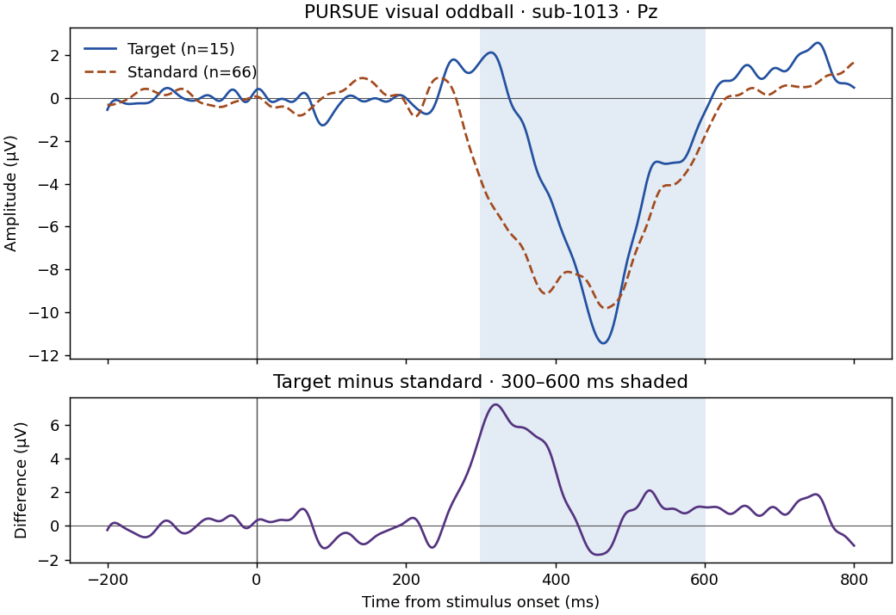

# Your first public EEG job on NSG

In the [NeuroTechX ERP lab](https://neurotechx.org/learn/labs/erp-averaging) you average simulated sound trials. Here you will use the same idea on a real visual oddball recording. The [PURSUE study](https://nemar.org/dataset/on007056) asked participants to respond to infrequent target letters. The job compares the responses to target and frequent letters at the scalp electrode Pz.

## Inspect a result first



Look at the interval from 300 to 600 ms after the letter appears. Which condition is more positive on average? Why might the target trace be noisier? The [trial counts](example/trial-counts.tsv) show that many fewer target trials were available, and about half the epochs in each condition exceeded the artifact threshold. The [run manifest](example/run-manifest.json) gives the window mean and the reasons for rejection. Use this example to learn how to read the output. The size and timing of the response can vary across recordings and preprocessing choices.

## Submit the job

1. [Register or sign in to NSG](https://nsgprod.sdsc.edu:8443/portal2/). The web portal uses your own NSG account.
2. Clone this repository and build an input ZIP with Python 3.11 or later.

   ```sh
   git clone https://github.com/NeuroTechX/nemar-nsg-starter.git
   cd nemar-nsg-starter/lessons/pursue-p300
   python3 prepare.py zip p300_erp.zip
   ```

3. Under **Data → Upload Data**, upload `p300_erp.zip`. Create a task with the **Python on Expanse** CPU tool (`PY_EXPANSE`). Set the main input file to `run.py` and its subdirectory to `p300_erp`. Request 0.5 hours and keep the default CPU settings. See the [portal walkthrough](../../docs/submit-portal.md) for the task screens.
4. After the task finishes, download its output archive and open `p300_erp/results/erp.png`. In the same directory, `erp.tsv` has the plotted traces in µV and their difference. Compare `trial-counts.tsv` and `run-manifest.json` with the example. If the results directory is missing, check the job log for an input or environment error.

The small ZIP reads the recording through `$NEMARPATH/ds007056`. The CPU tool was [previously observed](../../docs/env-snapshots/2026-09-22.md) to have that mirror and the required Python packages. This lesson's example was checked locally with those package versions. The lesson has yet to be tested on NSG.

### When the Expanse copy is unavailable

The dataset is public, and you can include just this recording and its BIDS metadata (about 27 MB total) in the ZIP. The download and the job both verify the exact input bytes against the [pinned manifest](source.json).

```sh
python3 prepare.py fetch data/ds007056
python3 prepare.py zip p300_erp_bundle.zip --include-data data/ds007056
```

Upload `p300_erp_bundle.zip` with the same task settings. The run will read the bundled files. If the download reports a checksum mismatch, retrieve the [1.1.1 snapshot](https://doi.org/10.18112/openneuro.ds007056.v1.1.1) through OpenNeuro, then use `--include-data` with that local copy.

## Reproduce the example locally

```sh
python3.11 -m venv .venv
. .venv/bin/activate
python -m pip install -r requirements.txt
python prepare.py fetch data/ds007056
python run.py --dataset-root data/ds007056 --preflight
python run.py --dataset-root data/ds007056
```

The preflight verifies input hashes and counts 34 target and 136 standard events. With the default settings, the checked local run retained 15 target and 66 standard epochs and measured a target-minus-standard amplitude of about **2.33 µV** across 300–600 ms at Pz. Positive values in the lower panel mean the target waveform is higher than the standard waveform at that time. Try adding `--channel Cz --output results/cz` to the last command and compare the response at the two electrodes.

The script uses the dataset event dictionary, filters continuous scalp EEG from 0.5 to 30 Hz, and extracts −200 to 800 ms around stimulus onset. It baseline-corrects using −200 to 0 ms and rejects epochs exceeding 150 µV peak-to-peak on a scalp EEG channel in the original reference. It re-references the retained trials to the scalp average before averaging each condition. Rejection reasons can overlap when several channels exceed the threshold in one epoch.

**Data credit.** J. W. Couperus, C. M. Bukach, and C. L. Reed, *PURSUE P300 Visual Oddball*, [OpenNeuro ds007056 v1.1.1](https://doi.org/10.18112/openneuro.ds007056.v1.1.1), CC0. The recording is also indexed as [NEMAR on007056](https://nemar.org/dataset/on007056).
